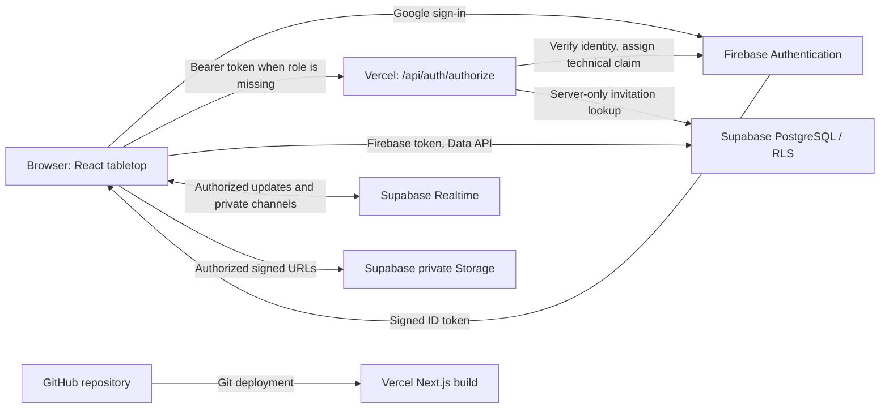

# Architecture

## Components and boundaries

The browser is not a trusted permission boundary. Supabase validates the token,
then database policies enforce access. Firebase identifies people; enabled
campaign invitations determine what they may access.

## Authentication flow

1. Google popup login creates or retrieves a Firebase user.
2. If the token lacks `role: authenticated`, the browser calls the Next.js server
   authorization route.
3. Firebase Admin verifies the token, expected project, Google provider and
   verified email. The server checks for an enabled invitation using its
   Supabase secret key, then assigns the technical claim.
4. The browser refreshes the Firebase token and supplies it to Supabase through
   the client's `accessToken` callback.
5. `bootstrap_current_user()` maintains the private profile and membership cache.
6. RLS checks the configured identity and current enabled invitation for
   subsequent access. `master`/`player` roles come from campaign data, not an
   administrator claim in a caller-controlled payload.

The server route has no independent campaign store. The service key stays on
the server; browser requests use the publishable key with the user's token.

## Repository map

| Location | Contents |
| --- | --- |
| `app/VersApp.tsx` | Login, bootstrap, campaign selection |
| `app/VersTable.tsx` | Tabletop and profile interface |
| `app/MacroDockRow.tsx`, `app/MacroRollModeControls.tsx` | Macro panel ordering and roll mode UI |
| `app/api/auth/authorize/route.ts` | Privileged identity-to-role bridge |
| `lib/firebase`, `lib/supabase` | Browser and server clients |
| `lib/vers` | Typed models and roll, asset URL, fog, movement and Realtime helpers |
| `supabase/migrations` | Versioned schema, permissions and database functions |
| `scripts` | Installation, role maintenance, dependency notices and security checks |
| `tests` | Node tests and disposable PostgreSQL fixtures |
| `.github` | CI and dependency-update configuration |

Types are maintained in TypeScript source; no generated database client or
deployed Supabase Edge Function is required by the current repository.

## Persistent data

Campaigns own scenes, assets and membership/invitation records. Each scene owns
its map/grid/fog settings, placed tokens, drawings and initiative state.
The master can inspect a different scene locally; the explicit player-scene
selection controls what players may view.

Characters belong to immutable Firebase UIDs and can be used across campaigns.
Macros, sections, ordering and temporary bonuses are persisted with the
appropriate character/account data. Roll history is stored in Postgres.
Full profile records are self-only; the campaign roster exposes a limited
projection instead of private email and account fields.

Storage contains image bytes; Postgres stores metadata and relationships.
The client renews short-lived signed URLs instead of keeping public bucket URLs.

## Realtime and cooperation

Database events notify clients about persisted changes. The browser makes
optimistic movement updates and reconciles with persisted state.
Private Broadcast channels carry transient interaction messages. Broadcast
hints about rolls or token visibility cause an authorized database reload,
rather than directly trusting the sender's payload.

Fog remains visual and dice are client-generated for cooperative play.
Read [SECURITY-MODEL.md](SECURITY-MODEL.md) for the exact limits.

## Naming and compatibility

Source components, modules, styles and configuration use the Vers name.
New installations use `vers-assets`, `vers_private` and `system:vers`.
Existing installations retain their stored IDs and select their existing file
bucket through `NEXT_PUBLIC_ASSET_BUCKET`. Browser dice preferences are imported
from a unique previous namespace on the same origin. See
[naming compatibility](RENAMING.md) before upgrading.

## Current limitations

Campaign creation and invitations are operator tasks documented in
[OPERATIONS.md](OPERATIONS.md). There is no public signup workflow, email
invitation service, built-in billing, general-purpose chat/journal system,
server-verified dice protocol, or server-side fog image redaction.
